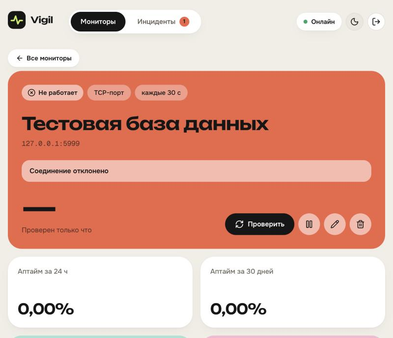
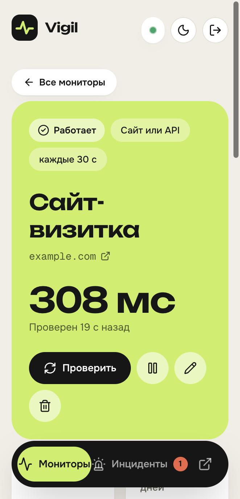
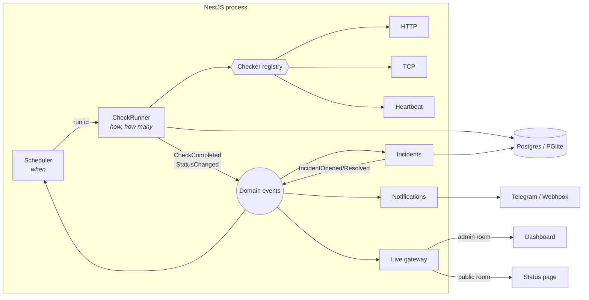

# Vigil

Self-hosted uptime monitor for a handful of sites and servers. Workers check HTTP endpoints, TCP ports and cron-job heartbeats; a React dashboard and a public status page update live over WebSocket; alerts go to Telegram or any webhook.

I built it to watch my own three sites and a VPS. It runs with **zero infrastructure** in development (Postgres is embedded via PGlite) and switches to a real Postgres with one env variable.

The interface is in Russian.

| Public status page                                    | Dashboard                                    |
| ----------------------------------------------------- | -------------------------------------------- |
|       |  |
| **A monitor that is down**                            | **Mobile**                                   |
|  |        |

## Features

- **Three monitor types**: HTTP(S) (status code ranges, keyword, slow-response threshold, SSL expiry), TCP port, and heartbeat (your cron job pings Vigil; silence means trouble).
- **No alert spam**: a monitor goes down only after N failed checks in a row; recovery is immediate.
- **Incidents** open and close automatically. The database itself guarantees one open incident per monitor.
- **Live everything**: check results, sparklines, today's uptime bar and incidents update without refresh. On reconnect the app refetches what it missed.
- **Public status page** that shows only what you mark public, under a public name — never URLs, hosts or error messages.
- **Alerts** via Telegram and a generic JSON webhook (Slack/Discord compatible).
- **Design**: bold cards, big display numbers, pill controls. Colour carries meaning: a monitor that is down turns its card tomato-red, one with problems turns yellow, healthy ones stay calm and white. Dark mode, mobile layout with a bottom tab bar.
- Small things that matter: background tab title and favicon show the number of monitors down, `N` opens a new monitor, uptime is rounded _down_ (99.996% never shows as 100%), light/dark theme without flash, keyboard-accessible charts, `prefers-reduced-motion` respected.

## Tech stack

|          |                                                                                                    |
| -------- | -------------------------------------------------------------------------------------------------- |
| Monorepo | npm workspaces, `@vigil/shared` contracts package                                                  |
| Backend  | NestJS 12 (ESM), Drizzle ORM, PostgreSQL / PGlite, native WebSocket (`ws`), zod                    |
| Frontend | React 19, React Router 8, TanStack Query, Tailwind CSS 4, react-hook-form, Onest + Unbounded fonts |
| Tooling  | TypeScript 7, Vite 8, Vitest, Biome                                                                |

## Architecture



### Decisions worth explaining

**Modules talk through domain events, not through each other.** The check runner records a result and emits `check.completed` / `monitor.status-changed`. It has no idea that incidents, alerts or WebSockets exist. Adding, say, a Prometheus exporter is one new listener — no existing file changes. Events are typed (`DomainEvents.emit` won't compile with the wrong payload).

**Checkers are strategies, discovered automatically.** Each monitor type is one class with `@MonitorChecker('http')`. `CheckerRegistry` finds them via Nest's `DiscoveryService`. A new type (DNS, ICMP, gRPC) = a zod schema in `shared` + one checker class.

**The scheduler is a port.** `CheckScheduler` is an abstract class; today it's bound to `InMemoryCheckScheduler` (chained `setTimeout` per monitor, start jitter, no overlapping runs). The runner owns concurrency (a semaphore) and dedupes parallel runs of the same monitor. Swapping in BullMQ for multiple worker processes is one class and one line in `SchedulerModule` — see the roadmap.

**One validation source of truth.** zod schemas in `@vigil/shared` validate the API (`ZodValidationPipe`) _and_ the form (`zodResolver`). Server issues come back as `{ path, message }` and are mapped onto form fields, so even a server-only error lands under the right input.

**Pre-aggregated uptime.** Every check bumps a per-monitor/per-UTC-day counter with an upsert in the same transaction. Raw checks are pruned after `CHECK_RETENTION_DAYS`; the 90-day bars and long-term uptime come from the rollups. The dashboard list loads sparklines for all monitors in one query with a `LATERAL` join that uses the `(monitor_id, checked_at desc)` index.

**Correctness details.**

- Flap protection: `nextMonitorState()` is a pure, unit-tested state machine.
- A pause wins over a check that was already running (`UPDATE ... WHERE status <> 'paused'`).
- Checks interrupted by our own shutdown are discarded, not recorded as outages.
- A crashing checker reports `down` with "Internal checker error" instead of silently stopping.

**Realtime without coupling the UI to sockets.** Socket events are written straight into the TanStack Query cache (`useAdminLiveSync`). Components only read queries and don't know a socket exists.

**Plain WebSocket, no Socket.IO.** One endpoint (`/api/live`), one JSON frame shape `{ type, data }` typed by a discriminated union in `@vigil/shared` (`LiveMessage`), so a wrong payload doesn't compile on either side. The parts a library would normally hide are small and explicit:

- _Audiences_: the session cookie is checked once at the handshake; signed-in sockets get `monitor:*` / `incident:*`, everyone gets the sanitized `status:*` events.
- _Keepalive_: the server pings every 30 s and terminates sockets that missed a pong (sleeping laptops, dropped Wi-Fi don't send a close frame).
- _Reconnect_: `LiveConnection` on the client retries with exponential backoff and jitter (1 s → 30 s), retries at once on the browser `online` event, and refetches queries after reconnecting, because events sent while offline are lost.
- No extra client library: the browser `WebSocket` is enough.

**Auth for one owner.** Password from env, compared via `timingSafeEqual` on SHA-256 digests, JWT in an `httpOnly` `SameSite=Lax` cookie, rate-limited login. Everything is private by default; public routes opt out with `@Public()`.

## Project layout

```
packages/shared/        zod schemas, DTOs, socket event types, formatting helpers
apps/api/src/
  monitors/             CRUD + status state machine
  checks/               checkers, runner, heartbeat endpoint, retention
  scheduler/            CheckScheduler port + in-memory adapter
  incidents/            open/resolve on status changes
  notifications/        Notifier interface, Telegram + webhook channels
  insights/             read side: dashboard overview, stats, public status page
  realtime/             WebSocket gateway: audiences, keepalive
  auth/ config/ database/ events/ health/
apps/web/src/
  features/             status-page, auth, admin, monitors, incidents
  components/           ui primitives, status visuals, SVG charts
  live/                 LiveConnection (reconnect/backoff) + typed useLiveEvent hook
  lib/                  api client, query client, time & format helpers
```

## Running locally

Requires Node 24+.

```bash
npm install
cp apps/api/.env.example apps/api/.env   # set ADMIN_PASSWORD and JWT_SECRET
npm run dev
```

- Status page: http://localhost:5173
- Dashboard: http://localhost:5173/admin
- API: http://localhost:3000/api (proxied by Vite in dev)

Data is stored in `apps/api/.data/pglite`. To use a real Postgres, set `DATABASE_URL`; migrations run on start either way.

```bash
npm test          # unit + integration tests (shared, api, web)
npm run typecheck
npm run lint      # Biome
npm run build
```

After changing `apps/api/src/database/schema.ts`: `npm run db:generate -w @vigil/api`.

### Heartbeat example

```cron
*/5 * * * *  /usr/local/bin/backup.sh && curl -fsS -m 10 --retry 3 https://status.example.com/api/heartbeat/<token> > /dev/null
```

The dashboard generates this snippet (crontab, curl, systemd) with the right schedule.

## Roadmap

- [ ] Docker Compose: Postgres + Redis + API + nginx serving the web build
- [ ] BullMQ adapter for `CheckScheduler` (`upsertJobScheduler`) and separate worker processes; Redis pub/sub fan-out for several API instances
- [ ] Maintenance windows (suppress alerts, show on status page)
- [ ] Notification channels configurable from the UI, per-monitor routing
- [ ] Checks from several regions with quorum before declaring an outage
- [ ] Playwright e2e tests for the main flows
