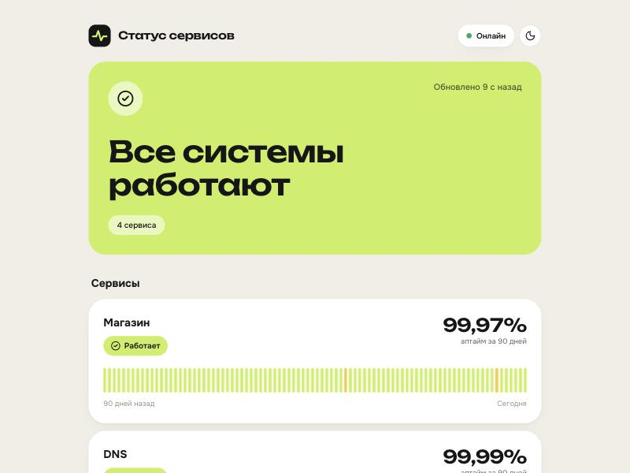
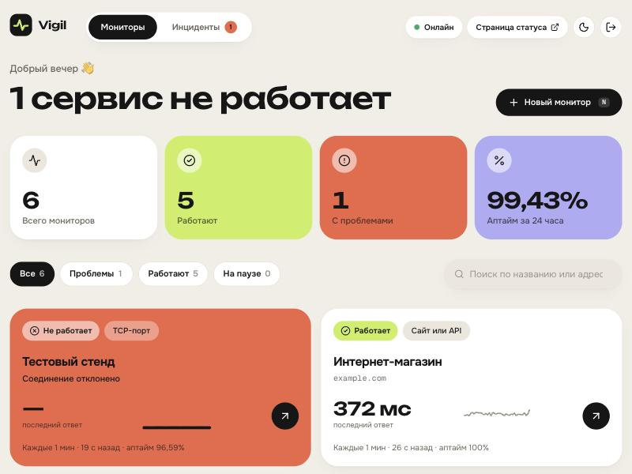
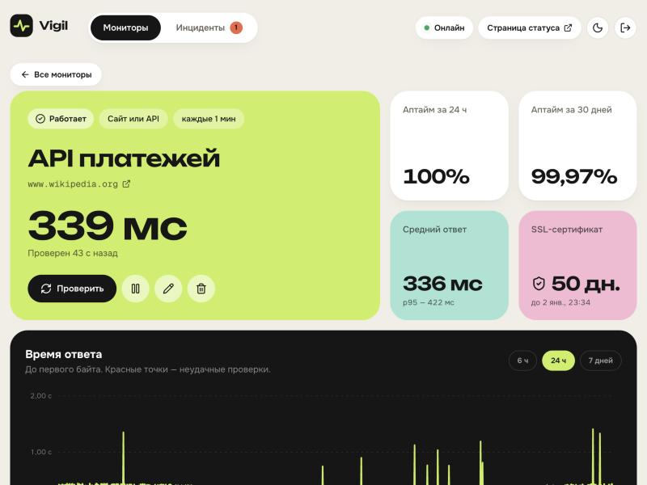
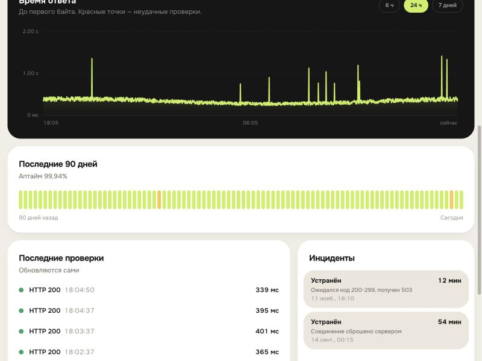
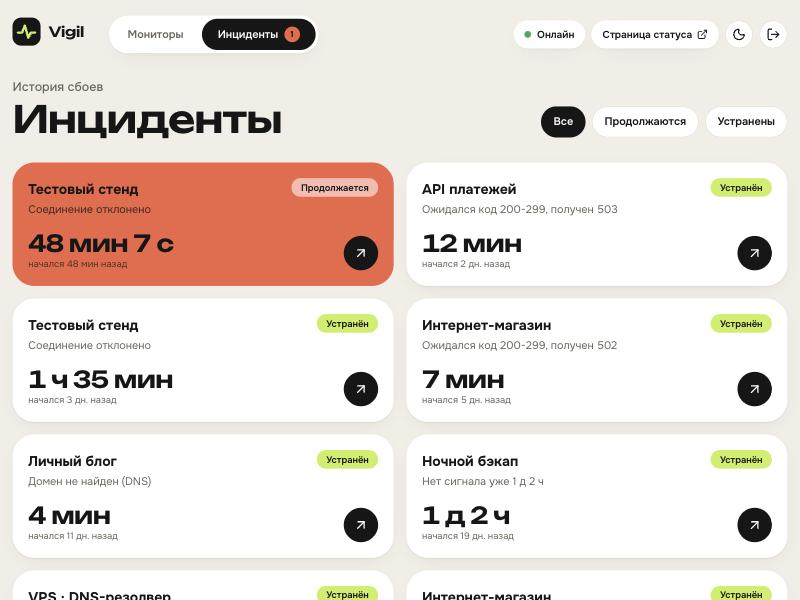
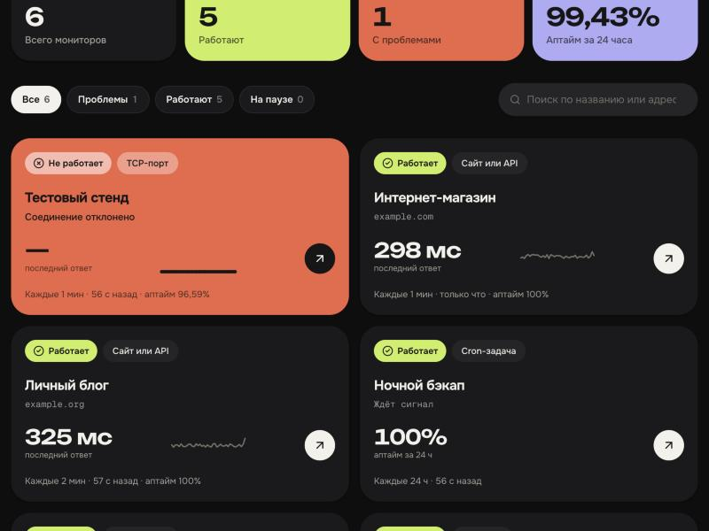
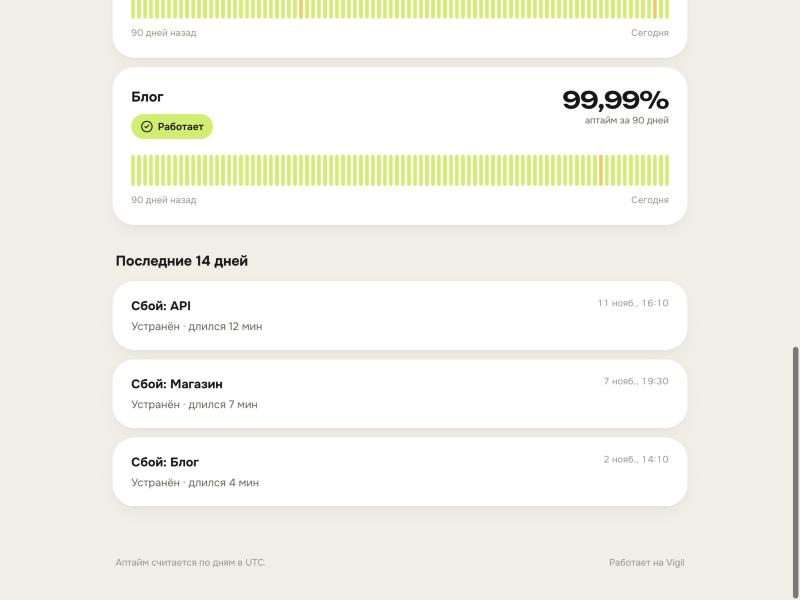
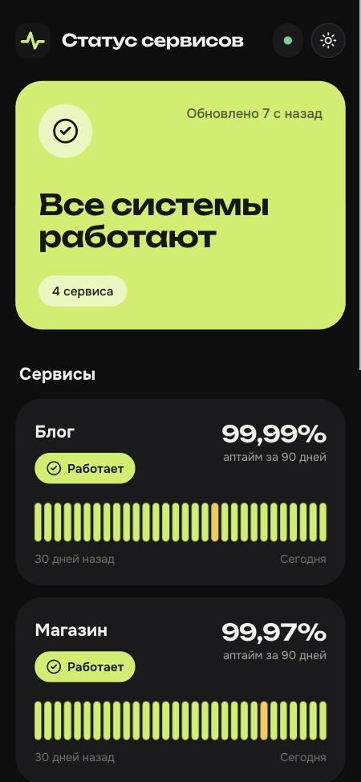
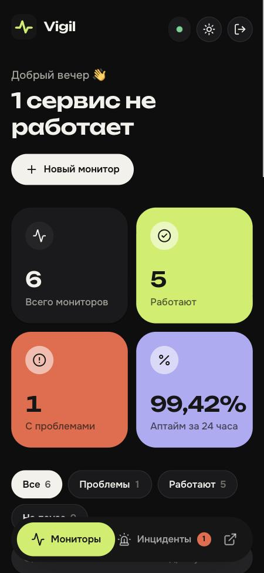
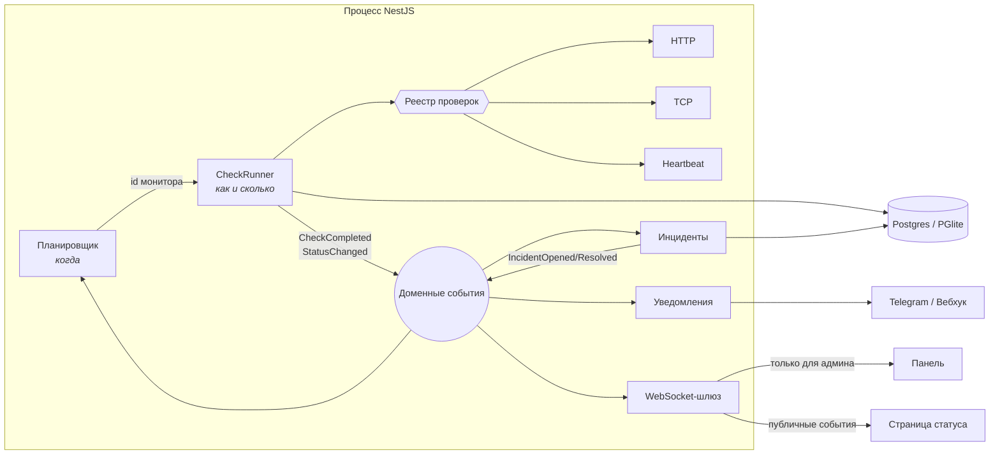

# Vigil

[](https://github.com/Kasatken/vigil-uptime/actions/workflows/ci.yml)

Мониторинг доступности для своих сайтов и серверов. Воркеры проверяют HTTP-адреса, TCP-порты и сигналы от cron-задач, панель управления и публичная страница статуса обновляются в реальном времени по WebSocket, уведомления приходят в Telegram или на любой вебхук.

Сделан, чтобы следить за моими тремя сайтами и VPS. Для разработки **не нужна никакая инфраструктура**: Postgres работает прямо внутри процесса (PGlite), а на настоящий Postgres приложение переключается одной переменной окружения.

Скриншоты сделаны на **синтетических демо-данных** (`npm run seed:demo`): история за 90 дней с несколькими реалистичными сбоями и одним монитором, который не работает прямо сейчас.



| Панель управления                                     | Страница монитора                                            |
| ----------------------------------------------------- | ------------------------------------------------------------ |
|              |     |
| **Время ответа, история за 90 дней, живой журнал**    | **Инциденты**                                                |
|  |                  |
| **Тёмная тема**                                       | **Страница статуса: история сбоев**                          |
|    |  |

<p align="center">
  
  &nbsp;&nbsp;
  
</p>

## Возможности

- **Три типа мониторов**: HTTP(S) (диапазоны кодов ответа, текст на странице, порог медленного ответа, срок SSL-сертификата), TCP-порт и heartbeat (cron-задача сама присылает сигнал; тишина означает проблему).
- **Без ложных тревог**: монитор считается упавшим только после N неудачных проверок подряд, восстановление фиксируется сразу.
- **Инциденты** открываются и закрываются сами. База данных гарантирует не больше одного открытого инцидента на монитор.
- **Всё обновляется вживую**: результаты проверок, графики, сегодняшний столбик аптайма и инциденты появляются без перезагрузки. После обрыва связи приложение само догружает пропущенное.
- **Публичная страница статуса** показывает только то, что вы отметили публичным, под публичным названием. Адреса, хосты и тексты ошибок посетители не видят никогда.
- **Уведомления** в Telegram и на JSON-вебхук (совместим со Slack и Discord).
- **Дизайн**: крупные карточки, большие цифры, кнопки-таблетки. Цвет несёт смысл: упавший монитор становится томатным, с проблемами — жёлтым, рабочие остаются спокойными белыми. Тёмная тема, мобильная версия с нижней панелью навигации.
- Мелочи, которые важны: заголовок вкладки и иконка показывают число упавших мониторов, клавиша `N` открывает создание монитора, аптайм округляется _вниз_ (99,996% никогда не покажется как 100%), тема без мигания при загрузке, графики доступны с клавиатуры, учитывается `prefers-reduced-motion`.

## Стек

|             |                                                                                                     |
| ----------- | --------------------------------------------------------------------------------------------------- |
| Монорепо    | npm workspaces, пакет общих контрактов `@vigil/shared`                                              |
| Бэкенд      | NestJS 12 (ESM), Drizzle ORM, PostgreSQL / PGlite, нативный WebSocket (`ws`), zod                   |
| Фронтенд    | React 19, React Router 8, TanStack Query, Tailwind CSS 4, react-hook-form, шрифты Onest и Unbounded |
| Инструменты | TypeScript 7, Vite 8, Vitest, Biome, GitHub Actions                                                 |

## Архитектура



### Решения, которые стоит объяснить

**Модули общаются через доменные события, а не вызывают друг друга.** CheckRunner записывает результат и публикует `check.completed` / `monitor.status-changed`. Он ничего не знает про инциденты, уведомления и WebSocket. Добавить, например, экспорт метрик в Prometheus — это один новый слушатель без правок в существующем коде. События типизированы: `DomainEvents.emit` не скомпилируется с неправильными данными.

**Проверки — это стратегии, которые находятся автоматически.** Каждый тип монитора — один класс с декоратором `@MonitorChecker('http')`. `CheckerRegistry` находит их через `DiscoveryService` из Nest. Новый тип (DNS, ICMP, gRPC) — это zod-схема в `shared` и один класс проверки.

**Планировщик — это порт.** `CheckScheduler` — абстрактный класс, сейчас к нему привязан `InMemoryCheckScheduler` (цепочка `setTimeout` на каждый монитор, случайная задержка при старте, проверки одного монитора не накладываются). Параллельностью управляет CheckRunner (семафор), он же склеивает одновременные запуски одного монитора. Переход на BullMQ с отдельными воркерами — это один класс и одна строка в `SchedulerModule`.

**Одна точка правды для валидации.** zod-схемы из `@vigil/shared` проверяют и API (`ZodValidationPipe`), и форму (`zodResolver`). Ошибки сервера приходят в виде `{ path, message }` и показываются под нужным полем формы.

**Аптайм считается заранее.** Каждая проверка в той же транзакции увеличивает счётчик за день (по UTC) через upsert. Сырые проверки удаляются через `CHECK_RETENTION_DAYS` дней, а 90-дневная история берётся из дневных счётчиков. Спарклайны для всех мониторов загружаются одним запросом с `LATERAL`-join, который использует индекс `(monitor_id, checked_at desc)`.

**Детали корректности.**

- Защита от «дребезга»: `nextMonitorState()` — чистая функция состояний, покрытая тестами.
- Пауза побеждает проверку, которая уже шла (`UPDATE ... WHERE status <> 'paused'`).
- Проверки, прерванные остановкой самого сервера, отбрасываются, а не записываются как сбой.
- Если проверка падает с ошибкой в коде, монитор получает статус `down` с текстом «Внутренняя ошибка проверки», а не молча перестаёт проверяться.

**Интерфейс не знает о сокетах.** События из WebSocket пишутся прямо в кэш TanStack Query (`useAdminLiveSync`). Компоненты только читают запросы.

**Чистый WebSocket, без Socket.IO.** Один адрес (`/api/live`), одна форма сообщения `{ type, data }`, типизированная размеченным объединением `LiveMessage` в `@vigil/shared`: неправильные данные не скомпилируются ни на сервере, ни на клиенте. То, что обычно прячет библиотека, здесь небольшое и явное:

- _Кому что отправлять_: cookie сессии проверяется один раз при подключении. Вошедшие получают `monitor:*` и `incident:*`, все остальные — только безопасные `status:*`.
- _Проверка живых соединений_: сервер раз в 30 секунд шлёт ping и закрывает сокеты, которые не ответили (уснувший ноутбук или пропавший Wi-Fi не присылают сигнал закрытия).
- _Переподключение_: `LiveConnection` на клиенте повторяет попытки с растущей паузой и случайным разбросом (от 1 до 30 секунд), сразу переподключается, когда браузер сообщает о появлении сети, и после переподключения обновляет данные, потому что сообщения за время обрыва потеряны.
- Никаких клиентских библиотек: хватает встроенного в браузер `WebSocket`.

**Авторизация для одного владельца.** Пароль из переменных окружения сравнивается через `timingSafeEqual` по SHA-256, JWT хранится в cookie `HttpOnly` с `SameSite=Lax`, число попыток входа ограничено. Всё закрыто по умолчанию, публичные адреса явно помечены `@Public()`.

## Структура проекта

```
packages/shared/        zod-схемы, DTO, типы WebSocket-событий, форматирование
apps/api/src/
  monitors/             CRUD и логика смены статуса
  checks/               проверки, CheckRunner, приём heartbeat, очистка старых данных
  scheduler/            порт CheckScheduler и реализация в памяти
  incidents/            открытие и закрытие инцидентов
  notifications/        интерфейс Notifier, каналы Telegram и вебхук
  insights/             чтение: обзор для панели, статистика, публичная страница
  realtime/             WebSocket-шлюз: получатели, проверка живых соединений
  scripts/              seed-demo: синтетическая история для демонстрации
  auth/ config/ database/ events/ health/
apps/web/src/
  features/             status-page, auth, admin, monitors, incidents
  components/           UI-примитивы, статусы, SVG-графики
  live/                 LiveConnection (переподключение) и типизированный useLiveEvent
  lib/                  API-клиент, кэш запросов, форматирование дат и чисел
```

## Локальный запуск

Нужен Node.js 24+.

```bash
npm install
cp apps/api/.env.example apps/api/.env   # задайте ADMIN_PASSWORD и JWT_SECRET
npm run seed:demo -w @vigil/api          # по желанию: синтетическая история за 90 дней
npm run dev
```

- Страница статуса: http://localhost:5173
- Панель управления: http://localhost:5173/admin

Данные хранятся в `apps/api/.data/pglite`. Перед `seed:demo` остановите dev-сервер: PGlite разрешает только один процесс на папку. Чтобы использовать настоящий Postgres, задайте `DATABASE_URL`, миграции применятся при запуске.

```bash
npm test          # модульные и интеграционные тесты (shared, api, web)
npm run typecheck
npm run lint      # Biome
npm run build
```

После изменения `apps/api/src/database/schema.ts`: `npm run db:generate -w @vigil/api`.

## Продакшен

`npm run build` и `NODE_ENV=production npm start` запускают **один процесс**, который отдаёт API, WebSocket и собранный React-интерфейс. Для HTTPS перед ним ставится Caddy или nginx. Пошаговая инструкция — VPS, systemd, Caddy, Telegram-бот, подключение своих сайтов и cron-задач — в [docs/SETUP.ru.md](docs/SETUP.ru.md).

## Безопасность

- Всё закрыто по умолчанию, публичные адреса явно помечены `@Public()`. Публичная страница и события `status:*` никогда не содержат адресов, хостов и текстов ошибок.
- Сессия: подписанный JWT в cookie с флагами `HttpOnly` и `SameSite=Lax`, плюс `Secure`, если `APP_URL` начинается с https. Вход ограничен 5 попытками в минуту с одного IP, пароль сравнивается за постоянное время.
- WebSocket: события админки получает только подключение с действующей сессией **и** с нашего домена (защита от перехвата WebSocket с чужого сайта). Мёртвые соединения закрываются по ping/pong.
- Заголовки через helmet: строгий CSP (`script-src 'self'`, без встроенных скриптов), HSTS, `nosniff`, `frame-ancestors 'self'`.
- В продакшене приложение не запустится с секретами из примера, коротким паролем или `APP_URL` без https.
- Все входные данные проверяются общими zod-схемами, HTTP-проверка читает не больше 1 МБ страницы.
- Осознанный компромисс: мониторы можно направить на любой адрес, включая внутренние. Ради этого мониторинг своих серверов и нужен, а создавать мониторы может только владелец.

### Пример heartbeat

```cron
*/5 * * * *  /usr/local/bin/backup.sh && curl -fsS -m 10 --retry 3 https://status.example.com/api/heartbeat/<токен> > /dev/null
```

Панель сама генерирует такую строку (crontab, curl, systemd) с правильным расписанием.

## Планы

- [ ] Docker Compose: Postgres, Redis, API
- [ ] Адаптер BullMQ для `CheckScheduler` (`upsertJobScheduler`) и отдельные воркеры; рассылка событий через Redis pub/sub для нескольких экземпляров API
- [ ] Окна обслуживания (без тревог, с отметкой на странице статуса)
- [ ] Настройка каналов уведомлений из интерфейса, свои каналы для каждого монитора
- [ ] Команды Telegram-бота: `/status`, `/pause`, утренняя сводка
- [ ] Проверки из нескольких регионов с подтверждением сбоя
- [ ] E2E-тесты на Playwright для основных сценариев
